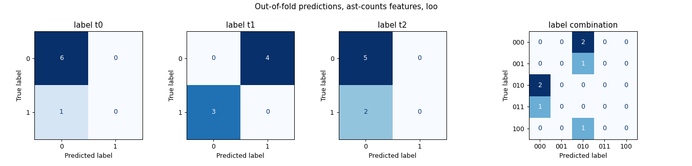

# Code Classifier

[](https://github.com/GabeMed/Code-Classifier/actions/workflows/ci.yml)

Predict which optimization techniques suit a Python program from its syntax tree alone. Each program is encoded as a vector ([ast2vec](https://github.com/inpefess/ast2vec)), and a random forest predicts one yes/no label per technique. Part of an undergraduate research project (CNPq) on machine-learning-guided optimization of Python programs.

This repo is a proof of concept on 7 labelled programs. The evaluation harness is complete and tested. The dataset is far too small for the accuracy numbers to mean much, and the results below say so.

## Problem

Input: the source of a Python program. Output: a 3-bit vector, one bit per optimization technique, where 1 means the technique suits the program. A program can have zero, one, or several techniques, so this is **multi-label** classification.

## Approach

1. **Parse** each program with Python's `ast` module. The programs are never executed.
2. **Embed** the syntax tree as a fixed-length vector. Two featurizers are available (`preprocess.py`):
   - `ast2vec`: the 256-d encoding from the pretrained ast2vec recursive tree autoencoder (Paaßen et al., 2021). This is the method of the project.
   - `ast-counts`: the relative frequency of each of the 107 AST node types (`Assign`, `For`, `Call`, ...). Standard library only. It is a simple baseline, and it lets the whole pipeline run and be tested without ast2vec or PyTorch.
3. **Classify** with `StandardScaler` → `RandomForestClassifier(n_estimators=100)` (multi-output), as in the original scripts.
4. **Evaluate** (`crossval.py`):
   - leave-one-out cross-validation, plus the original 3-fold split for comparison;
   - the scaler is refit inside every fold;
   - the model is compared with a per-label majority baseline;
   - the random-forest seed is varied, and a 200-shuffle label-permutation test asks whether the score beats chance.

## Dataset

`data/exp1.py` … `data/exp7.py`: seven small benchmark programs (naive Fibonacci, array copies, a Monte Carlo draw, look-and-say, belief propagation, a root finder, heap permutations). They import `intpy` (`@deterministic`, `initialize_intpy`), but here they are only parsed. Labels are in `preprocess.py` (`LABELS`), keyed by file name:

| Program | Labels (t0 t1 t2) |
|---|---|
| exp1.py, exp2.py | 0 0 0 |
| exp3.py | 0 0 1 |
| exp4.py, exp5.py | 0 1 0 |
| exp6.py | 0 1 1 |
| exp7.py | 1 0 0 |

The original code does not record which technique each bit stands for, so they are called `t0`, `t1` and `t2` here. It also paired labels with files in `os.listdir` order, which is not guaranteed. The labels are now keyed by file name, in the order they were written (exp1 … exp7).

## Results

Out-of-fold predictions on all 7 programs. The numbers come from `make baseline` (`results/ast-counts_*.md`). A test checks that the committed files match a fresh run.

| Features | CV | Exact-match accuracy | Hamming accuracy | RF seed spread (exact match, 10 seeds) | Permutation p |
|---|---|---:|---:|---:|---:|
| Majority baseline | LOO | 0.286 | 0.714 | – | – |
| AST node counts + RF | LOO | 0.000 | 0.524 | 0.057 ± 0.070 | 1.00 |
| AST node counts + RF | 3-fold | 0.143 | 0.714 | 0.143 ± 0.090 | 0.74 |
| ast2vec + RF | LOO / 3-fold | not run in this revision | | | |

Per-label results (AST node counts, LOO): precision, recall and F1 are 0.00 for every label. There are 1, 3 and 2 positive programs for `t0`, `t1` and `t2`.



**How to read this.** On 7 programs, no configuration beats the majority baseline, and the permutation test cannot tell the model from shuffled labels. The 0/7 under leave-one-out is partly an artifact of the protocol. When a positive program is held out, the training fold has fewer positives; when a negative program is held out, it has more. A model that mostly follows the label balance therefore gets `t1` wrong on all 7 programs. This result says the dataset is too small to measure anything. It does not show that the features lack signal.

**ast2vec row.** The ast2vec featurizer needs code and a pickled PyTorch model from the ast2vec repository, which is not on PyPI. It is fetched by `make ast2vec` and was not executed for this revision. To fill in the row:

```bash
make setup && make ast2vec && make cv   # writes results/ast2vec_{loo,kfold3}.{json,md}
```

## Limitations

- **7 programs.** Any accuracy estimate has a standard error of up to about ±0.19. Tens to hundreds of labelled programs are needed before the comparison between featurizers means anything.
- **Label meaning is undocumented** in the code (see Dataset).
- **Syntax only.** Both featurizers see the tree, not runtime behaviour, input sizes, or data types, which often decide whether caching, vectorization or parallelism pays off.
- **ast2vec** was trained on short student programs (Paaßen et al.), which may not match benchmark-style code. It also pins Python < 3.13.

## How to run

Requires [uv](https://docs.astral.sh/uv/) and Python 3.11 (`.python-version`).

```bash
make setup                      # .venv + pinned environment (requirements.lock)
make baseline                   # CV with AST node counts -> results/
make ast2vec                    # optional: clone ast2vec at a pinned commit into vendor/, install torch (CPU)
make cv                         # CV with ast2vec (FEATURES=ast2vec is the default)
make split                      # single 70/30 split demo (classifier.py)
```

Or call the scripts directly: `python crossval.py --features {ast2vec,ast-counts} --cv {loo,kfold3} --permutations 200`.

## Tests

```bash
make test    # ruff + pytest, about 10 s, no ast2vec or torch needed
```

The 18 tests cover:

- **Loading:** labels follow file names, not directory order, and every program parses.
- **Featurizer:** exact node-count features on a known snippet; the vocabulary covers real stdlib code.
- **Setup errors:** the ast2vec featurizer fails with setup instructions when ast2vec is missing.
- **Metrics:** checked by hand, including that `[0,0,0]` and `[1,0,0]` stay distinct. The old confusion matrix used `argmax`, which merged them.
- **Pipeline:** the scaler is inside the CV pipeline; the harness recovers a clean synthetic signal; the majority baseline gives the expected 2/7 and 15/21.
- **Results:** `crossval.py` runs end to end, and the committed results reproduce exactly.

GitHub Actions runs lint and tests on every push to `master` and every pull request.

## Structure

```text
Code-Classifier/
├── preprocess.py          # load programs + labels; ast2vec and ast-counts featurizers
├── crossval.py            # main entry point: CV, baseline, seed spread, permutation test, report
├── classifier.py          # single train/test split demo
├── data/exp1.py … exp7.py # labelled programs (parsed, never run)
├── results/               # committed CV reports and confusion matrices
├── tests/
├── Makefile
├── requirements.txt       # numpy, scikit-learn, matplotlib (pinned)
├── requirements-ast2vec.txt  # + torch, astor, for the ast2vec featurizer
├── requirements-dev.txt   # + pytest, ruff
└── requirements.lock      # full resolution used by CI
```

## Credit

The program embeddings come from **ast2vec** by Benjamin Paaßen and Jessica McBroom (University of Sydney), packaged by Boris Shminke: <https://github.com/inpefess/ast2vec> (GPL-3.0). It is fetched at setup time, not redistributed here. Paper: B. Paaßen, J. McBroom, B. Jeffries, I. Koprinska, K. Yacef. *Mapping Python Programs to Vectors using Recursive Neural Encodings.* Journal of Educational Data Mining, 2021.
